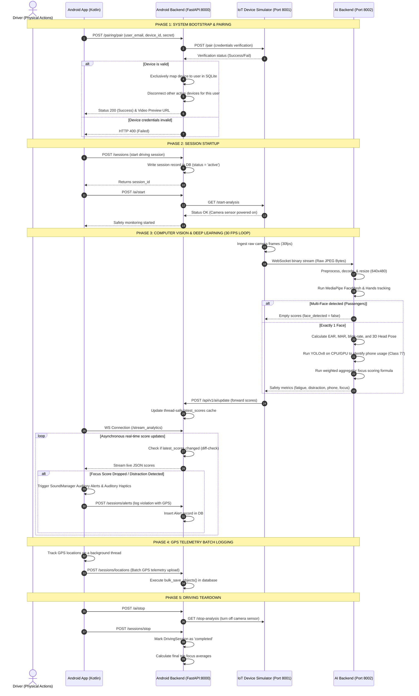
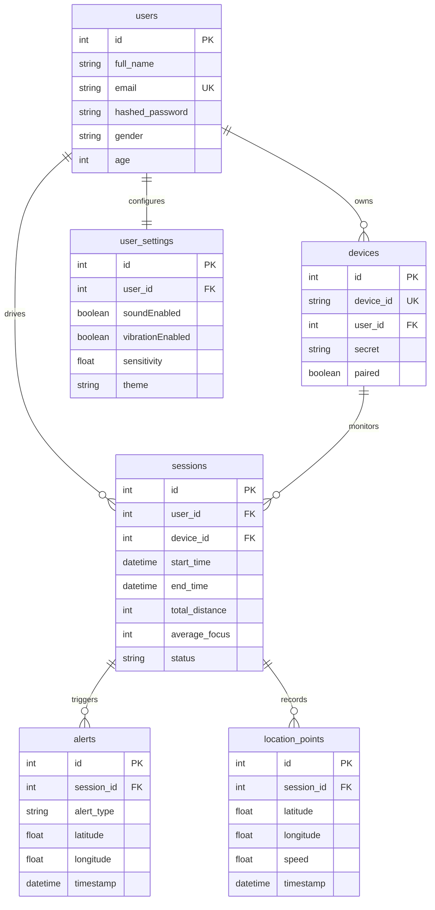

# DriveMind DMS: Complete System Architecture & Orchestration Guide

This document presents the complete architectural layout, logical workflows, and data relationships for the **DriveMind Driver Monitoring System (DMS)**. It details how the **Android Mobile App**, **Android Backend**, **IoT Device Simulator**, and **AI Processing Backend** coordinate to process low-latency, real-time safety telemetry.

---

## 1. System-Wide Component Topology

The system comprises four decoupled, concurrent nodes that communicate over asynchronous network protocols (HTTP REST and WebSockets):

```mermaid
graph TB
    subgraph Android App [Android Mobile Application]
        UI[Jetpack Compose View] <--> VM[ViewModel]
        VM <--> UC[Use Case]
        UC <--> Repo[Repository]
        Repo <--> Net[Retrofit OkHttp API]
        Repo <--> WS_Client[WebSocket Client]
        Repo <--> GPS[Location Manager]
    end

    subgraph Port 8000 [Android Backend (FastAPI)]
        Router[API Routers] <--> Schema[Pydantic Schemas]
        Router <--> Serv[Services Layer]
        Serv <--> DB_Model[SQLAlchemy Models]
        DB_Model <--> SQLite[(SQLite Database)]
        Serv <--> Integr[IoT Integration Client]
        Router <--> Cache[In-Memory latest_scores Cache]
        Router <--> WS_Stream[WebSocket Stream Router]
    end

    subgraph Port 8001 [IoT Device Simulator (FastAPI)]
        Camera[Camera / Frames Simulator]
        WS_Sender[WebSocket Sender]
        Control[HTTP Control APIs]
    end

    subgraph Port 8002 [AI Backend (FastAPI)]
        AI_WS[WebSocket Stream Endpoint] <--> Prep[Preprocessor]
        Prep <--> Mesh[MediaPipe FaceMesh & Hands]
        Prep <--> Agg[Aggregator]
        Agg <--> Yol[YOLOv8 Object Detection]
        Agg <--> Temp[Temporal Stateful Models]
    end

    %% Network Connections
    Net <-->|REST API over HTTP| Router
    WS_Client <-->|Asynchronous Score Stream| WS_Stream
    Integr <-->|HTTP Device Control| Control
    Camera -->|Raw Frame Stream| WS_Sender
    WS_Sender <-->|Raw JPEG Frame Bytes| AI_WS
    AI_WS -->>|Live Fatigue & Distraction Scores| WS_Sender
    WS_Sender -->|POST AI Scores /ai/update| Router
    GPS -->|GPS Telemetry batch log| Router
```

---

## 2. End-to-End Orchestration Loop & Logical Sequence

The diagram below details the entire system lifecycle—from device pairing and session start to frame-by-frame deep-learning inference, audio alerts, and telemetry persistence:



---

## 3. Database Entity-Relationship Diagram (ERD)

The database schema (`drivemind.db` SQLite) maps the relational telemetry that links users, physical paired devices, driving logs, GPS tracking points, and safety alerts:



---

## 4. Logical Interaction Breakdown

The system represents a decoupled orchestrator architecture where nodes have explicit roles and zero logical leakage:

1. **Active Telemetry Ingestion (Fast Ingress)**:
   The Android Mobile App runs a background GPS service utilizing [LocationRepository.kt](file:///c:/Users/crasy/OneDrive/Bureau/s2%20ia2i/mobile/dms_ba/DMS/android/app/src/main/java/com/example/dms_app/core/location/LocationRepository.kt). Telemetry data is saved locally and periodically uploaded in batches (`POST /api/v1/sessions/locations`) to prevent network congestion.
   
2. **Video Processing & Deep Learning Pipeline**:
   The physical IoT device acts as the edge node. It captures camera video frames and streams raw JPEG bytes to `backend_AI` (Port `8002`). The AI engine extracts landmarks (MediaPipe) and evaluates object classes (YOLOv8) asynchronously.
   
3. **Reactive WebSocket Scores Broker**:
   Once safety evaluations are made, the IoT edges push results to `android_backend` (Port `8000`) at `/ai/update`. The backend acts as a low-latency broker by immediately distributing the scores to the active Android app over a WebSocket stream (`ws://.../stream_analytics`), ensuring real-time driver alert feedback.
