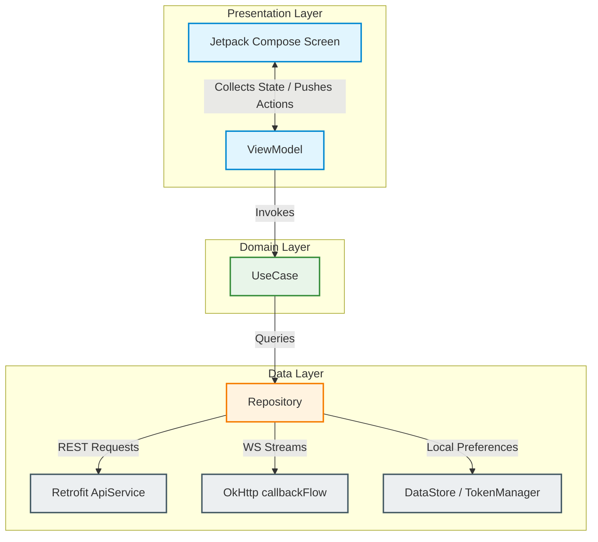

# DriveMind DMS Android Client: Architectural Blueprint & Guide

This document provides a highly detailed walkthrough of the **DriveMind DMS (Driver Monitoring System) Android Mobile Application**. It explains the system's Clean Architecture structure, details the **MVVM + Use Case + Repository** design pattern, explains the responsibilities and boundaries of each layer, and illustrates why each component is used and how they coordinate together in Kotlin and Jetpack Compose.

---

## 1. Architectural Philosophy: Clean Architecture & MVVM

The application strictly implements **Clean Architecture** decoupled into isolated, feature-driven modules. The presentation layer utilizes the **Model-View-ViewModel (MVVM)** pattern. 

### Why Clean Architecture?
1. **Decoupling from Frameworks**: The core business logic (Domain) is kept independent of UI libraries, database clients, or hardware sensors, making it robust against technology migrations.
2. **High Testability**: Since each class has a single responsibility, it is simple to write unit tests for Use Cases and Repositories by mocking standard boundary interfaces.
3. **Scalability**: Multiple developers can work on separate feature packages concurrently without experiencing Git merge conflicts or code regression.

---

## 2. Directory Structure & Folder Contract

The codebase is organized using a **feature-based** structure inside the package directory `com.example.dms_app`:

```text
android/app/src/main/java/com/example/dms_app/
├── core/                         # Reusable Shared Infrastructure
│   ├── config/                   # Global Host IP & URL settings
│   ├── database/                 # Preferences & Local Token DataStore
│   ├── location/                 # Shared GPS Location tracking service
│   ├── navigation/               # NavGraph routes & MainScreen bottom-tabs
│   ├── network/                  # Retrofit ApiClient, interfaces, and shared DTOs
│   ├── ui/                       # Shared UI theme & reusable Compose components
│   └── utils/                    # General utility helpers
├── feature_auth/                 # Feature: Splash, Onboarding, Login, Signup
├── feature_device/               # Feature: QR code scanning & Bluetooth/IoT pairing
├── feature_drive/                # Feature: Camera previews & local drive orchestrators
├── feature_livedrive/            # Feature: Live AI stream, WebSocket, auditory alerts
├── feature_home/                 # Feature: Focus score dashboard & metrics
├── feature_alerts/               # Feature: Custom alert tracking
└── feature_profile/              # Feature: User metadata & settings
```

Every individual feature is subdivided into **three strict Clean Architecture layers**:
```text
feature_name/
├── data/                         # Data Layer (Repositories, DB/API bindings)
├── domain/                       # Domain Layer (Business Rules & UseCases)
└── presentation/                 # Presentation Layer (Composables, ViewModels, UI State)
```

---

## 3. Deep-Dive: Layer Responsibilities & Contracts



---

### 3.1 The Presentation Layer (MVVM)

#### Why is it used?
It acts as the system's visual interface. It separates UI layout specifications from state retention and coordination logic, ensuring screens remain lightweight, passive, and free of networking or business decisions.

#### Component Breakdown:
* **The View (Jetpack Compose Screen)**: 
  * **Role**: Renders UI components based strictly on the current immutable state and triggers callbacks in response to user inputs.
  * **Rule**: Must remain completely passive. It collects the state in a lifecycle-aware manner (`collectAsStateWithLifecycle`) and forwards events (like button clicks) directly to the ViewModel.
* **The ViewModel**:
  * **Role**: Holds the state, launches asynchronous coroutines inside `viewModelScope`, invokes Domain Use Cases, handles operational errors, and exposes an immutable `StateFlow<UiState>`.
  * **Rule**: Never expose mutable state flows (`MutableStateFlow`) publicly. Never import Android UI classes, views, or Jetpack Compose properties.
* **UI State (`UiState`)**:
  * **Role**: An immutable data class summarizing everything the screen needs to render (e.g. data values, boolean loading gates, or optional error string fields).
  * **Rule**: State updates must be made atomic using the `.copy()` function on immutable objects.

#### Practical Code Example:
```kotlin
// presentation/login/LoginUiState.kt
data class LoginUiState(
    val email: String = "",
    val isLoading: Boolean = false,
    val error: String? = null,
    val success: Boolean = false
)

// presentation/login/LoginViewModel.kt
class LoginViewModel(app: Application) : AndroidViewModel(app) {
    private val repository = AuthRepository()
    private val loginUseCase = LoginUseCase(repository)

    private val _state = MutableStateFlow(LoginUiState())
    val state: StateFlow<LoginUiState> = _state

    fun updateEmail(value: String) {
        _state.value = _state.value.copy(email = value)
    }

    fun login() {
        viewModelScope.launch {
            _state.value = _state.value.copy(isLoading = true, error = null)
            try {
                val result = loginUseCase(LoginRequest(_state.value.email))
                _state.value = _state.value.copy(isLoading = false, success = true)
            } catch (e: Exception) {
                _state.value = _state.value.copy(isLoading = false, error = e.message)
            }
        }
    }
}
```

---

### 3.2 The Domain Layer (Clean Use Cases)

#### Why is it used?
The Domain layer represents the **business rules** of the application. It acts as a translation layer that extracts logic from ViewModels, keeping operations clean, reusable across screens, and fully mockable for unit testing.

#### Component Breakdown:
* **Use Cases (Interactors)**:
  * **Role**: Exposes a single, single-purpose operation (e.g. `LoginUseCase`, `ObserveAiResultsUseCase`). It coordinates repositories to execute a specific task.
  * **Logic**: Exposes itself using Kotlin's `operator fun invoke` so it behaves like a callable function.
  * **Rule**: Strictly independent of third-party libraries, networks, databases, or UI assets.

#### Practical Code Example:
```kotlin
// domain/LoginUseCase.kt
class LoginUseCase(private val repository: AuthRepository) {
    
    // Single-purpose operator mapping
    suspend operator fun invoke(request: LoginRequest): AuthResponse {
        return repository.login(request)
    }
}
```

---

### 3.3 The Data Layer (Data Repositories & Clients)

#### Why is it used?
The Data layer is the app's gateway to the outside world. It coordinates local and remote data sources, manages Retrofit API interfaces, connects real-time OkHttp WebSockets, and accesses local system hardware (camera, GPS sensors, DataStore local preferences).

#### Component Breakdown:
* **Repositories**:
  * **Role**: Abstract the data source away from domain and presentation logic. A Use Case never knows whether the data was loaded from a local memory cache, a DataStore file, or a remote server.
  * **Bridges**: Converts low-level streams and hardware callback listeners into standard Kotlin coroutines (`suspend` functions and `Flow`).
  * **WebSocket Streams**: Wraps complex async listener architectures using `callbackFlow` to turn raw network sockets into clean, safe reactive streams.

#### Practical Code Example:
```kotlin
// data/LiveDriveRepository.kt
class LiveDriveRepository {
    private val client = OkHttpClient.Builder().readTimeout(0, TimeUnit.MILLISECONDS).build()

    // Wrap raw OkHttp WebSocket listeners into an asynchronous Kotlin Flow stream
    fun observeAiResults(): Flow<String> = callbackFlow {
        val request = Request.Builder()
            .url("${AppConfig.WS_BASE_URL}api/v1/ai/stream_analytics")
            .build()

        val listener = object : WebSocketListener() {
            override fun onMessage(webSocket: WebSocket, text: String) {
                trySend(text) // Push raw JSON to Flow collector
            }

            override fun onClosing(webSocket: WebSocket, code: Int, reason: String) {
                close() // Close flow
            }

            override fun onFailure(webSocket: WebSocket, t: Throwable, response: Response?) {
                close(t) // Propagate socket failure to Flow collector
            }
        }

        val ws = client.newWebSocket(request, listener)

        // Automatically release socket connection when collector cancels coroutine scope
        awaitClose {
            ws.close(1000, "Scope closed")
        }
    }
}
```

---

## 4. The Complete Reactive Data Flow Loop

```text
1. JETPACK COMPOSE SCREEN
   collectAsStateWithLifecycle() collects the ViewModel's state.
   User inputs data or presses a button (e.g., "Start Drive").
   │
   ▼
2. VIEWMODEL (PRESENTATION)
   Exposes a read-only StateFlow<UiState>.
   Launches a coroutine in viewModelScope and triggers the UseCase.
   │
   ▼
3. USE CASE (DOMAIN)
   Performs validation/business checks.
   Executes domain logic and calls repository methods.
   │
   ▼
4. REPOSITORY (DATA)
   Connects to local database, GPS systems, or remote REST/WebSockets.
   Returns a Flow stream or suspends waiting for an API response.
   │
   ▼
5. SYSTEM / SERVER BOUNDARY
   Retrofit yields a REST DTO, or OkHttp listens to WebSocket streams.
   ▲
   │  Flowing back up: Data returns as pure domain/data entities
   └───► Repositories yield clean outputs
          └───► UseCases parse/map data structures
                 └───► ViewModel calls `.copy()` to push a new immutable State
                        └───► Jetpack Compose recomposes the Screen visually
```

---

## 5. Architectural Advantages & Core Strengths

> [!TIP]
> The app is built with exceptional reactive hygiene, achieving low-latency streaming and high memory safety.

* **Textbook Reactive Streams**: The use of `callbackFlow` combined with `awaitClose` prevents memory leaks, ensuring that WebSockets and GPS locations are automatically closed when a user leaves the screen.
* **Granular UI States**: Standardizing immutable `UiState` objects allows the Jetpack Compose engine to intelligently recompose only the specific sub-widgets whose values changed, saving mobile battery.
* **Clean State Transitions**: ViewModels update states atomically using `copy()`, eliminating race conditions during rapid user actions.
* **Excellent Modularization**: Strictly isolating framework components in the `core` layer ensures that third-party library dependencies (like Retrofit or OkHttp) can be updated or replaced without modifying feature files.

---

## 6. Guidelines for Developers & Future Extensions

> [!IMPORTANT]
> When adding new features, all developers must adhere to the following rules:

1. **Keep Compose Screens Lean**: Never place network calls, JSON parsing, or persistent storage operations inside a Compose screen. Screens should only render state and trigger ViewModel events.
2. **Never Expose Mutable State**: Always hide mutable states privately in the ViewModel:
   ```kotlin
   private val _state = MutableStateFlow(MyUiState())
   val state: StateFlow<MyUiState> = _state
   ```
3. **Use Constructor Injection**: Inject repositories into Use Cases and Use Cases into ViewModels, keeping classes fully mockable for unit testing.
4. **Enforce Clean Architecture Boundaries**: 
   * `Presentation` depends on `Domain` and `Data`.
   * `Domain` depends only on `Data` boundaries or raw models (independent of UI libraries).
   * `Data` relies on `Core` infrastructure.
   * `Core` is completely independent and has zero dependencies on individual features.
5. **Always Clean Up Long-Running Tasks**: Track and clean up active Coroutine Jobs when a user stops monitoring or navigates away.
