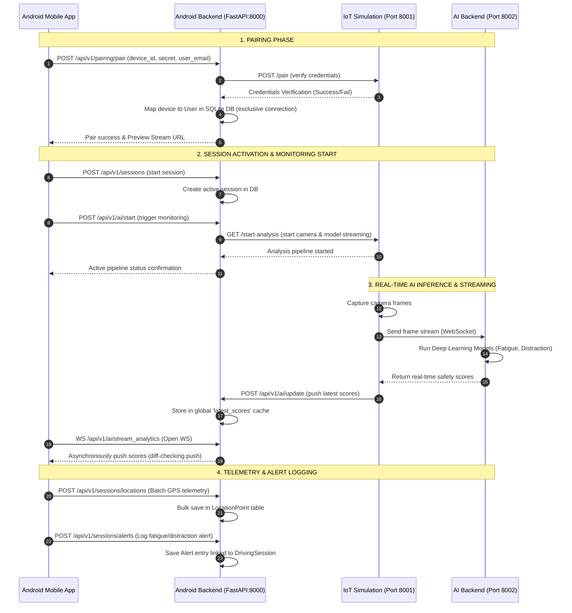

# DriveMind DMS Android Backend: Architectural Analysis & Guide

This document provides a highly detailed walkthrough of the **DriveMind DMS (Driver Monitoring System) Android Backend**. It explains the system's architecture, underlying business and orchestration logic, data flows, and offers an objective analysis of its **strengths** and **weaknesses** with actionable recommendations for production readiness.

---

## 1. Directory Structure & Architectural Blueprint

The backend is built using the **FastAPI** framework and follows a clean, decoupled **Layered Service-Oriented Architecture (SOA)**. It segregates routing, request validation, business logic, persistence, and external system integrations into explicit boundaries, ensuring that each component has a single responsibility.

```text
android_backend/
├── app/
│   ├── api/                   # Routing Layer (FastAPI)
│   │   └── v1/
│   │       ├── api.py         # Router Aggregator
│   │       └── routes/        # Endpoint Handlers (Thin Controllers)
│   ├── core/                  # Configuration, Environments & Security Utilities
│   ├── db/                    # DB Session and Engine Setup (SQLAlchemy)
│   ├── integrations/          # External Microservice Clients (IoT, AI)
│   ├── models/                # SQLAlchemy Core Database Entities
│   ├── schemas/               # Pydantic Schemas (Input Validation / DTOs)
│   ├── services/              # Core Business Logic & DB Transactions
│   ├── utils/                 # General Utility Functions
│   └── main.py                # Service Entry Point & DB Table Bootstrapping
├── drivemind.db               # Local SQLite Database File
└── ANDROID_BACKEND_LLM_RULES.md # Development & Design Guidelines
```

### Component Responsibility Matrix

| Layer | Path | Responsibility | Decoupling Constraint |
| :--- | :--- | :--- | :--- |
| **API Endpoints** | [routes/](file:///c:/Users/crasy/OneDrive/Bureau/s2%20ia2i/mobile/dms_ba/DMS/android_backend/app/api/v1/routes) | Receive requests, authenticate users, invoke services, return JSON. | **Strictly no business or DB logic.** |
| **Validation DTOs** | [schemas/](file:///c:/Users/crasy/OneDrive/Bureau/s2%20ia2i/mobile/dms_ba/DMS/android_backend/app/schemas) | Validate incoming requests and serialize outgoing HTTP responses. | **No database session access.** |
| **Business Logic** | [services/](file:///c:/Users/crasy/OneDrive/Bureau/s2%20ia2i/mobile/dms_ba/DMS/android_backend/app/services) | Manage transactions, perform calculations, run database queries. | **Never reference FastAPI decorators/routes.** |
| **Persistence Models** | [models/](file:///c:/Users/crasy/OneDrive/Bureau/s2%20ia2i/mobile/dms_ba/DMS/android_backend/app/models) | Define database tables, relationships, and data types. | **Strictly schema declarations only.** |
| **Integrations** | [integrations/](file:///c:/Users/crasy/OneDrive/Bureau/s2%20ia2i/mobile/dms_ba/DMS/android_backend/app/integrations) | Communicate with the IoT Device Simulator (Port 8001). | **Unaware of HTTP requests or sessions.** |
| **Core Utilities** | [core/](file:///c:/Users/crasy/OneDrive/Bureau/s2%20ia2i/mobile/dms_ba/DMS/android_backend/app/core) | Manage environment configs, JWT tokens, password hashing. | **Shared, infrastructure-level helper logic.** |

---

## 2. Core Logical Flows & Orchestration

The backend operates as an **orchestration hub** connecting the **Android Mobile App**, the **IoT Device** (camera preview/hardware), and the **AI Processing Engine** (fatigue/distraction models).

### 2.1 The Global System Orchestration Loop
The following diagram illustrates the lifecycle of pairing, starting a driving session, streaming real-time inference telemetries, and saving analytics:



---

### 2.2 Deep-Dive into Logical Implementations

#### A. Exclusive Device Pairing Logic ([pairing.py](file:///c:/Users/crasy/OneDrive/Bureau/s2%20ia2i/mobile/dms_ba/DMS/android_backend/app/api/v1/routes/pairing.py) & [profile_service.py](file:///c:/Users/crasy/OneDrive/Bureau/s2%20ia2i/mobile/dms_ba/DMS/android_backend/app/services/profile_service.py))
To avoid conflicts, a hardware device can only be paired to one user at a time. The pairing rules enforce the following logic:
1. **IoT Verification**: Calls `IoTClient.verify_device()` to validate that the physical hardware exists and is configured.
2. **Re-assignment (Exclusive Ownership)**: If a device is already registered in the DB under a different user, the service automatically transfers ownership of that device to the registering user (`device.user_id = user_id`).
3. **Single Active Device Rule**: When a user pairs with a device (`isConnected=True`), all other devices previously owned by that user are set to `paired=False` (offline) to ensure only one sensor feeds data at a time.

#### B. Telemetry & Alert Logging ([drive_service.py](file:///c:/Users/crasy/OneDrive/Bureau/s2%20ia2i/mobile/dms_ba/DMS/android_backend/app/services/drive_service.py))
During a driving session, the mobile app posts continuous location and safety alert data.
* **Bulk Location Upload**: Instead of making a separate database query for every single GPS ping, the backend supports `log_locations()` which takes a batch of coordinates and executes a fast `bulk_save_objects` transaction.
* **Alert Logging**: Relates critical safety violations (e.g., drowsiness, phone use) to the active `DrivingSession`, capturing the exact geographical coordinates and timestamp of the incident.

#### C. Analytics & Density Heatmap Generator ([insight_service.py](file:///c:/Users/crasy/OneDrive/Bureau/s2%20ia2i/mobile/dms_ba/DMS/android_backend/app/services/insight_service.py))
The insights engine compiles statistical averages of driving habits (average focus, distance traveled, trip frequency) and builds a **7x8 Alert Density Heatmap Matrix**:
* **Dimensions**: 7 rows representing the days of the week (Monday to Sunday) and 8 columns representing 3-hour time blocks (00:00 to 24:00).
* **Matrix Logic**: It iterates over all logged alerts for a user, aggregates their timestamps into the corresponding day/hour grid cell, and maps the total occurrence counts to structural risk levels ranging from `0` (no alerts) to `5` (very high risk: >= 10 alerts).

---

## 3. Core Strengths (Powerful Features)

> [!TIP]
> The backend demonstrates excellent architectural hygiene, lightweight footprints, and powerful telemetry processing capabilities.

* **Strict Separation of Concerns**: The route files are thin, declarative entry points. The separation between DTO validation (`schemas`), persistence (`models`), and core transactions (`services`) ensures that code changes are highly modular and easy to isolate.
* **Efficient Database Operations**: The use of SQLAlchemy bulk operations (`bulk_save_objects`) for telemetry uploads prevents database lockup during high-frequency GPS coordinate writes.
* **Fast and Responsive WebSocket Streaming**: The backend acts as a highly reactive broker. By maintaining a local diff check (`latest_scores != last_sent`), the WebSocket stream only pushes updates to the Android UI when the values actually change, saving mobile battery and CPU overhead.
* **Robust Request Validation**: Out-of-the-box data structure verification powered by Pydantic prevents bad payloads, missing parameters, or invalid types from reaching database models, eliminating corrupted database states.
* **Rich Analytics Engine**: Highly advanced analytical services exist directly in the core. The risk density heatmap and week-over-week safety trend scores provide sophisticated analytical capabilities natively, without requiring external analytics tools.

---

## 4. Architectural & Security Weaknesses (Critical Vulnerabilities)

> [!WARNING]
> While the design architecture is clean, there are several structural limitations, thread-safety bugs, and security vulnerabilities that must be addressed before this backend can handle multiple active production users.

### 4.1 In-Memory Global State Concurrency & Isolation Issues
* **The Vulnerability**: In `app/api/v1/routes/ai.py`, the variable `latest_scores` is defined as a global, single dictionary:
  ```python
  latest_scores = {}
  ```
* **Why it is critical**: 
  1. **Multi-User Collision**: If User A and User B are driving simultaneously, both of their IoT simulators will call `/api/v1/ai/update`, overwriting the same global `latest_scores` dict. Both users will receive mixed real-time data, resulting in a severe data leakage breach where User A sees User B's fatigue scores.
  2. **Multi-Process Desynchronization**: Standard FastAPI servers are launched with multiple worker processes (Uvicorn workers). Since global variables are isolated to process memory spaces, a POST request updating scores on Process #1 will never update the WebSocket stream running on Process #2, leading to missing data streams.

### 4.2 Sync, Blocking Network Calls inside Asynchronous Routes
* **The Vulnerability**: The `IoTClient` uses python's synchronous `requests` library inside API routers:
  ```python
  # app/integrations/iot_client.py
  def verify_device(self, device_id: str, secret: str):
      response = requests.post(f"{self.BASE_URL}/pair", ...)
  ```
* **Why it is critical**: FastAPI is designed around an asynchronous event loop. When a route executes a synchronous network call (`requests.post`), the entire event loop thread is **blocked** waiting for that request to resolve. If one external IoT simulator takes 3 seconds to respond, all other connected clients, WebSockets, and database operations will freeze until that single network call completes.

### 4.3 Insecure Direct Object References (IDOR) / Access Control Risks
* **The Vulnerability**: Multiple endpoints pull settings or profile data by relying strictly on the `user_id` passed in the URL path or schema payload:
  ```python
  # app/api/v1/routes/settings.py
  @router.get("/{user_id}", response_model=UserSettingsResponse)
  def get_user_settings(user_id: int, db: Session = Depends(get_db)):
  ```
* **Why it is critical**: The route does not compare the requested `user_id` against the identity inside the caller's JWT authentication token. An authenticated malicious user can query or modify the settings, profiles, driving sessions, and telemetry files of **any other user** simply by changing the `user_id` integer in their API requests.

### 4.4 Hardcoded Secrets & Config Variables
* **The Vulnerability**: Production credentials, cryptographic secrets, and ports are hardcoded in the codebase:
  * In `security.py`: `SECRET_KEY = "dev-secret-key-change-later"`
  * In `iot_client.py`: `BASE_URL = "http://127.0.0.1:8001"`
* **Why it is critical**: Standard security frameworks forbid committing plaintext secrets to source control. Hardcoded base URLs block environment flexibility (e.g. testing in staging, Docker, or production clouds) without modifying code files.

### 4.5 SQLite Write Constraints & Lack of DB Migrations
* **The Vulnerability**: 
  1. The database relies on standard SQLite (`drivemind.db`) in write-heavy telemetry scenarios.
  2. Tables are generated dynamically via `Base.metadata.create_all(bind=engine)` inside `main.py` without a migration tool like Alembic.
* **Why it is critical**: 
  1. SQLite locks the entire database file during writes. High numbers of simultaneous writes (e.g. dozens of drivers uploading coordinates every 2 seconds) will lead to frequent `sqlite3.OperationalError: database is locked` exceptions, crashing transactions.
  2. Modifying schemas (e.g., adding a database column) requires manually dropping database tables or deleting `drivemind.db`, causing complete data loss in production since the engine cannot execute structural database migrations safely.

---

## 5. Actionable Refactoring Roadmap

To transition this backend into a production-ready, highly secure, and horizontally scalable service, prioritize these five core improvements:

### Step 1: Replace Global Memory Cache with Redis
Replace the local `latest_scores` dict with a fast, thread-safe in-memory store like **Redis**. Key each sensor stream by the unique session or device ID to achieve total multi-tenant security:
```python
# Refactored websocket key-based check
async def stream_analytics(session_id: int, websocket: WebSocket):
    # Fetch from Redis keyed by session_id: 'session:{session_id}:scores'
```

### Step 2: Use Async Clients (`httpx`) for Integrations
Refactor `IoTClient` to use `httpx.AsyncClient` so that external network requests do not block the event loop:
```python
import httpx

class IoTClient:
    async def verify_device_async(self, device_id: str, secret: str):
        async with httpx.AsyncClient() as client:
            response = await client.post(f"{self.BASE_URL}/pair", ...)
            return response.json()
```

### Step 3: Implement Token Identity Enforcement
Introduce a FastAPI security dependency checking the JWT payload against the input request `user_id`:
```python
def verify_user_ownership(user_id: int, current_user: User = Depends(get_current_active_user)):
    if current_user.id != user_id:
        raise HTTPException(status_code=403, detail="Access denied: Resource ownership mismatch")
```

### Step 4: Environment Variables Deployment
Enforce Pydantic BaseSettings to pull secrets, environments, and base URLs from environment parameters or `.env` files:
```python
from pydantic import BaseSettings

class Settings(BaseSettings):
    SECRET_KEY: str
    IOT_BASE_URL: str = "http://127.0.0.1:8001"
    
    class Config:
        env_file = ".env"
```

### Step 5: Integrate Alembic for Database Migrations
Initialize **Alembic** in `android_backend` (`alembic init alembic`) and configure it to read the metadata in `app/db/base.py` to gain structural, safe database revision controls.
