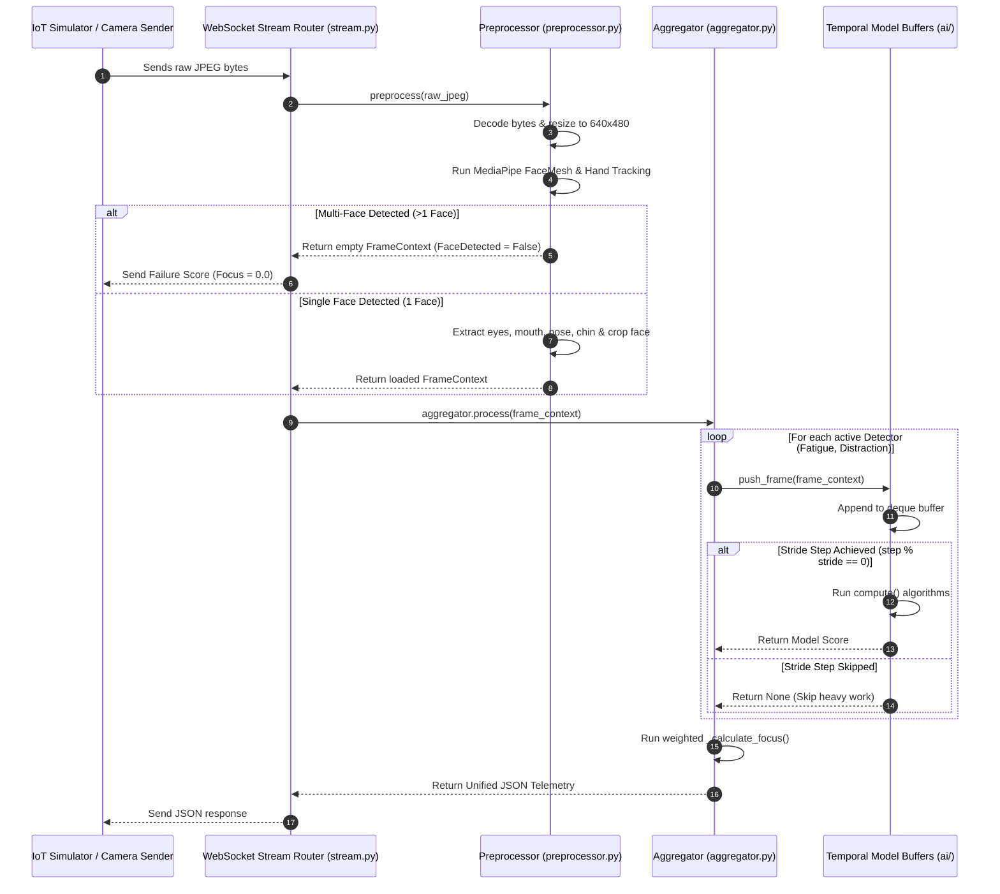

# DriveMind DMS AI Backend: Deep Architectural Analysis & Guide

This document provides a highly detailed walkthrough of the **DriveMind DMS (Driver Monitoring System) AI Backend**. It explains the system's architecture, underlying computer vision and deep learning pipelines, data flows, and offers an objective analysis of its **strengths** and **weaknesses** with actionable recommendations for production scaling.

---

## 1. Directory Structure & Architectural Blueprint

The AI backend is a specialized microservice responsible for ingesting live video streams, running computer vision algorithms, and outputting real-time safety scores. It is built using **FastAPI** with raw asynchronous **WebSockets**, utilizing **MediaPipe** for landmarks and **YOLOv8** for object classification.

```text
backend_AI/
├── ai/                        # The AI/CV Core Detector Engine
│   ├── distraction/           # Head Pose & Gaze Estimation Modules
│   ├── emotion/               # YOLOv8 Facial Expression Classification
│   ├── fatigue/               # EAR, MAR, and Blink Tracking State Machine
│   ├── phone_usage/           # YOLOv8 Object Detection (Cell Phone Class)
│   ├── BaseInstantDetector.py # 1-Frame Immediate Calculation Abstract Class
│   ├── BaseTemporalDetector.py# Sliding-Window Temporal Memory Abstract Class
│   └── registry.py            # Model Registry
├── api/                       # API Layer
│   └── routes/
│       ├── health.py          # Liveness Checks
│       └── stream.py          # High-Performance WebSocket Stream Router
├── core/                      # Global Configurations, Settings, and Logger
├── pipeline/                  # Ingestion Pipeline
│   ├── aggregator.py          # Multitask Model Coordinator (JSON Combiner)
│   ├── frame_context.py       # Pure Data Dataclass Container (FrameContext)
│   └── preprocessor.py        # Decoding, Multi-Face Rejection & Landmark Mapper
├── yolov8n.pt                 # YOLOv8 Nano Pretrained Weights File
└── requirements.txt           # Python CV, ML, and Web Libraries
```

### Component Responsibility Matrix

| Component | Path | Responsibility | Performance Constraint |
| :--- | :--- | :--- | :--- |
| **Stream Router** | [api/routes/stream.py](file:///c:/Users/crasy/OneDrive/Bureau/s2%20ia2i/mobile/dms_ba/DMS/backend_AI/api/routes/stream.py) | Host WebSocket endpoint, ingest JPEG bytes, push output JSON. | **Must not block; handles frame loop.** |
| **Preprocessor** | [pipeline/preprocessor.py](file:///c:/Users/crasy/OneDrive/Bureau/s2%20ia2i/mobile/dms_ba/DMS/backend_AI/pipeline/preprocessor.py) | Decodes JPEG, resizes to 640x480, extracts MediaPipe landmarks. | **Primary CPU performance bottleneck.** |
| **Data Container** | [pipeline/frame_context.py](file:///c:/Users/crasy/OneDrive/Bureau/s2%20ia2i/mobile/dms_ba/DMS/backend_AI/pipeline/frame_context.py) | Holds extracted facial, hand, iris points, and raw images. | **Immutability; strictly zero business logic.** |
| **Aggregator** | [pipeline/aggregator.py](file:///c:/Users/crasy/OneDrive/Bureau/s2%20ia2i/mobile/dms_ba/DMS/backend_AI/pipeline/aggregator.py) | Distributes frames to detectors, aggregates weighted safety scores. | **Computes focus score on active face.** |
| **Base Detectors** | [ai/BaseTemporalDetector.py](file:///c:/Users/crasy/OneDrive/Bureau/s2%20ia2i/mobile/dms_ba/DMS/ai/BaseTemporalDetector.py) | Provides a stateful sliding-window deque buffer and stride-check. | **Buffers frames temporally to smooth noise.** |

---

## 2. Core Logical Flows & AI Pipelines

The AI backend functions as an **in-memory data processing pipeline** that processes raw video frames to assess driver alertness.

### 2.1 The Frame Ingestion & Evaluation Lifecycle



---

### 2.2 Deep-Dive into AI Algorithms & Mathematical Logic

#### A. Preprocessing & Multi-Face Rejection Rule ([preprocessor.py](file:///c:/Users/crasy/OneDrive/Bureau/s2%20ia2i/mobile/dms_ba/DMS/backend_AI/pipeline/preprocessor.py))
To prevent passengers or children inside the vehicle from interfering with the driver's safety pipeline, the preprocessor implements a strict **Multi-Face Rejection Rule**:
* It configures MediaPipe FaceMesh with `max_num_faces=2`.
* If `len(multi_face_landmarks) != 1` (meaning 0 faces or 2+ faces are visible), the pipeline immediately rejects the frame by returning an empty `FrameContext` with `face_detected=False`. This effectively ignores background passengers.

#### B. High-Precision 3D Head Pose Estimation ([head_pose.py](file:///c:/Users/crasy/OneDrive/Bureau/s2%20ia2i/mobile/dms_ba/DMS/backend_AI/ai/distraction/head_pose.py))
Instead of basic geometric ratios, the distraction model maps six 2D face coordinates (nose, outer eyes, corners of the mouth, chin) against a standardized 3D human head model using OpenCV:
1. **SolvePnP**: Estimates rotation ($R$) and translation ($T$) vectors using iterative perspective-n-point projection (`cv2.solvePnP`).
2. **Stable RQ Decomposition**: Converts the rotation matrix to Euler angles using RQ decomposition (`cv2.RQDecomp3x3`).
3. **Euler Angles**: Extracts **Pitch** (nodding up/down), **Yaw** (looking left/right), and **Roll** (tilting head side-to-side) without gimbal lock risk, normalizing values against configurable alarm thresholds.

#### C. Angle-Compensated Gaze Direction ([gaze_direction.py](file:///c:/Users/crasy/OneDrive/Bureau/s2%20ia2i/mobile/dms_ba/DMS/backend_AI/ai/distraction/gaze_direction.py))
Determines whether a driver's eyes are focused on the road or looking away (e.g. at a phone or dashboard):
1. **Ellipse Fitting**: Fits mathematical ellipses (`cv2.fitEllipse`) around eye contours.
2. **Iris Offsets**: Calculates offsets between the eye contour center and the iris center coordinates.
3. **Angle Compensation**: Uses trigonometric rotation math derived from the eye contour angle to cancel out head-tilt skew. This prevents head movements from generating false positive gaze alerts.

#### D. Stateful Blink-Rate Tracking Machine ([fatigue/detector.py](file:///c:/Users/crasy/OneDrive/Bureau/s2%20ia2i/mobile/dms_ba/DMS/backend_AI/ai/fatigue/detector.py))
Rather than just checking instantaneous eye closure, the system operates a state machine that tracks actual blinking:
* **Aspect Ratios**: Computes Eye Aspect Ratio (EAR) and Mouth Aspect Ratio (MAR) using standard Euclidean distance formulas ([fatigue_math.py](file:///c:/Users/crasy/OneDrive/Bureau/s2%20ia2i/mobile/dms_ba/DMS/backend_AI/ai/fatigue/fatigue_math.py)).
* **State Transition**: A blink is registered only when the eye transitions from a `CLOSED` state ($EAR < 0.22$) to an `OPEN` state ($EAR \ge 0.22$).
* **Droop Tracking**: The exact timestamps of these blinks are stored in a rolling array. If the number of blinks within a rolling 5-second window falls below the threshold ($MIN\_BLINKS = 1$), the blink score increases to maximum risk, signifying that the driver's eyes are drooping without blinking.

---

## 3. Core Strengths (Powerful Features)

> [!TIP]
> The AI backend represents a highly sophisticated computer vision engine leveraging robust, mathematical approaches over heavy, black-box deep learning.

* **Lightweight Telemetry Payload**: By processing raw bytes via WebSockets and returning tiny serialized JSON packages, the network overhead is minimal, maximizing performance over cellular connections.
* **Smart Stride-Based Execution**: The temporal detector base class skips intensive computer vision processing on skipped frames (e.g. processing only 1 out of every 5 frames). This drops CPU utility drastically while keeping a high-rate ingestion buffer.
* **Stable Head & Eye Geometry Math**: Using RQ decomposition and horizontal/vertical iris compensation prevents false alarms triggered by normal driving movements, offering professional-grade noise filtering.
* **Intelligent Noise Buffering**: Detections are smoothed temporally using sliding-window arrays, preventing jitter or single-frame blinks from triggering false positive alerts.
* **Clever Passenger Filter**: Rejects multi-face frames immediately, ensuring passenger movement in the background does not corrupt the safety analysis.

---

## 4. Architectural & Algorithmic Weaknesses (Critical Risks)

> [!WARNING]
> While the mathematics and algorithms are solid, the runtime architecture possesses serious multi-tenant desynchronization risks, CPU bottlenecks, and environment portability issues.

### 4.1 Global Aggregator Singleton (Multi-Tenant State Corruption)
* **The Vulnerability**: In [stream.py](file:///c:/Users/crasy/OneDrive/Bureau/s2%20ia2i/mobile/dms_ba/DMS/backend_AI/api/routes/stream.py), the router imports and uses a shared global instance of `Aggregator`:
  ```python
  from pipeline.aggregator import aggregator
  ```
* **Why it is critical**: `aggregator` is a global singleton holding stateful temporal models (`FatigueDetector`, `DistractDetector`). 
  If **Driver A** and **Driver B** stream video simultaneously, both connections will push frames into the **same** sliding-window buffer. Driver A's eye aspect ratio will be calculated using Driver B's frame sequence, completely corrupting the temporal buffer and resulting in completely inaccurate alert triggers for both drivers.

### 4.2 Single-Threaded CPU YOLOv8 Bottleneck
* **The Vulnerability**: The `PhoneDetector` loads a YOLOv8 network (`yolov8n.pt`) and forces execution on the CPU:
  ```python
  self.device = 'cpu'
  self.model = YOLO('yolov8n.pt').to(self.device)
  ```
* **Why it is critical**: Running YOLOv8 on raw frames on a standard CPU takes between 80ms to 200ms per frame. Since the FastAPI event loop is single-threaded, executing this heavy synchronous model inside the main WebSocket thread blocks the server. This bottleneck explains why `phone` and `emotion` models are commented out in `aggregator.py`.

### 4.3 Thread-Safety Risks in Global MediaPipe Detectors
* **The Vulnerability**: In `preprocessor.py`, MediaPipe objects are initialized globally:
  ```python
  face_mesh = mp_face.FaceMesh(...)
  hands_detector = mp_hands.Hands(...)
  ```
* **Why it is critical**: MediaPipe's underlying C++ wrappers are not thread-safe. Concurrent asynchronous frame requests attempting to call `.process(rgb)` simultaneously on these shared global objects will trigger race conditions, resulting in memory segmentation faults and sudden server crashes.

### 4.4 Portability & Hardcoded File Paths
* **The Vulnerability**: The codebase contains hardcoded Windows file system paths:
  * In `aggregator.py`: `model_path = "C:\\Users\\crasy\\OneDrive\\Bureau\\s2 ia2i\\mobile\\DMS\\backend\\ai\\phone_usage\\yolov8n.pt"`
* **Why it is critical**: Any attempt to run this code on another developer's workstation, inside a Docker container, or on a Linux cloud instance will crash instantly due to path unresolved errors.

### 4.5 Blocking Image Manipulation inside Asynchronous Loop
* **The Vulnerability**: Decoding images (`cv2.imdecode`) and resizing (`cv2.resize`) are heavy CPU tasks executed directly in the async thread.
* **Why it is critical**: Heavy CPU tasks executed without the `await` keyword block the event loop, preventing FastAPI from processing other concurrent connections.

---

## 5. Actionable Refactoring Roadmap

To prepare this AI microservice for concurrent users, performance stability, and clean cloud deployment, implement the following steps:

### Step 1: Instantiation Isolation (Resolve State Corruption)
Eliminate the shared global `aggregator` singleton. Instantiate a fresh, dedicated `Aggregator` instance inside each active WebSocket scope so that each user has isolated temporal buffers:
```python
# Refactored api/routes/stream.py
@router.websocket("/stream")
async def stream(websocket: WebSocket):
    await websocket.accept()
    # FRESH INSTANCE PER WEB SOCKET CONNECTION
    user_aggregator = Aggregator()
    
    try:
        while True:
            jpeg_bytes = await websocket.receive_bytes()
            frame_context = preprocess(jpeg_bytes)
            # Isolated computation
            result = user_aggregator.process(frame_context)
            await websocket.send_json(result)
```

### Step 2: Thread-Safe Local Detector Management
Initialize MediaPipe instances inside the thread pool or instantiate them within the connection context rather than using global, shared objects to ensure thread-safety.

### Step 3: Offload YOLOv8 Inference to a Background Process / GPU
* If a GPU is available, update the model to use CUDA: `self.device = 'cuda'`.
* If running on CPU, offload the YOLO inference task to a separate process pool using Python's `concurrent.futures.ProcessPoolExecutor` to prevent blocking the async event loop.

### Step 4: Convert Hardcoded Paths to Relative Configuration Paths
Move all paths to the config utility and use standard path resolving methods:
```python
import os
from pathlib import Path

# Relative path resolving
BASE_DIR = Path(__file__).resolve().parent.parent
MODEL_PATH = os.getenv("YOLO_MODEL_PATH", str(BASE_DIR / "yolov8n.pt"))
```

### Step 5: CPU-bound Thread Offloading
Wrap synchronous image operations in a thread pool executor using FastAPI's standard run-in-executor methods:
```python
import asyncio

# Run CPU-bound image decoding in thread pool
loop = asyncio.get_event_loop()
image = await loop.run_in_executor(None, cv2.imdecode, arr, cv2.IMREAD_COLOR)
```
